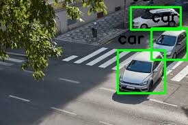
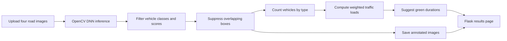

<div align="center">

# AI-Traffic

### See the queue. Rethink the green.

Four road images. Vehicle counts by type. Suggested green-light durations.<br>
A computer vision prototype connecting what a camera sees to how long a signal could stay green.


[See the output](#a-look-at-the-output) · [How it works](#from-road-images-to-timing-suggestions) · [Timing logic](#not-every-vehicle-counts-the-same) · [Run locally](#run-locally)

</div>

---

## A signal should have something to go on

Different roads carry different loads. Counting a bus exactly like a motorbike also misses part of the picture.

AI-Traffic explores a simple idea: **detect vehicles in road images, translate those counts into weighted traffic loads, and use those loads to suggest green-light durations**. A Flask interface accepts four images, runs detection through OpenCV's DNN module, and displays annotated results, vehicle counts, and a duration for each image.

The detector estimates vehicle presence; a separate, hand-written timing heuristic converts those counts into seconds. The project processes still images and displays suggestions. It does not connect to traffic-signal hardware or implement a live intersection controller.

## A look at the output

<p align="center">
  
</p>

*An annotated image already included in the repository. This is a saved example, not a newly generated benchmark or a screenshot of the full web interface.*

For each of the four inputs, the results page shows:

- The image with selected bounding boxes and class scores.
- Separate counts for **cars, buses, trucks, and motorbikes**.
- A suggested **green-light duration in seconds**.

## From road images to timing suggestions



### Detection pipeline

| Step | Implementation |
| :--- | :--- |
| Model loading | `cv2.dnn.readNet` with the bundled `yolov7.weights` and `yolov7.cfg` filenames |
| Class names | Loaded from `coco.names` |
| Input preparation | 416 × 416 blob, pixel scale `1/255`, RGB channel swap |
| Candidate selection | Maximum class score greater than `0.4`, restricted to four vehicle classes |
| Overlap filtering | Greedy suppression of boxes with IoU greater than `0.8` |
| Output | Bounding boxes, class scores, per-class counts, and saved annotated images |

The code uses the maximum class score directly, without multiplying it by objectness. Overlap suppression is applied across all selected vehicle classes rather than separately within each class.

The model files carry `yolov7` names in this repository; their training provenance and model-version identity are not documented. Those filenames alone are not a verified architecture claim.

## Not every vehicle counts the same

The timing function converts counts into **equivalent car units (ECUs)** using fixed weights:

| Vehicle | ECU weight |
| :--- | ---: |
| Motorbike | 0.5 |
| Car | 1.0 |
| Bus | 2.5 |
| Truck | 3.0 |

For each road image:

```text
weighted load = cars + 0.5 × motorbikes + 2.5 × buses + 3 × trucks
initial green time = weighted load × 5 seconds
```

It then applies an image-position-dependent factor and a minimum-time floor. If the sum of initial times exceeds 150 seconds, it also scales the resulting durations by `150 / total_initial_time`.

### What the timing function actually returns

For four images each containing four cars and no other vehicles, the current function returns:

| Image position | Weighted load | Suggested green time |
| :--- | ---: | ---: |
| 1 | 4 ECU | 10.00 s |
| 2 | 4 ECU | 11.89 s |
| 3 | 4 ECU | 14.14 s |
| 4 | 4 ECU | 16.82 s |

These values were checked by running the timing function independently of the detector. Equal vehicle loads produce different times because the formula depends on image position. The 10-second floor is applied before the overloaded-cycle scaling, so final times can fall below 10 seconds. The function does not allocate an exact 150-second cycle.

This makes the timing logic an experimental heuristic, not a learned or optimized signal policy. There are no pedestrian phases, amber intervals, clearance times, or conflicting-movement constraints in the implementation.

## Run locally

### 1. Clone and install

Use a Python environment compatible with your Flask, NumPy, and OpenCV versions. The repository does not pin dependency versions.

```bash
git clone https://github.com/Arnavsmayan/AI-Traffic.git
cd AI-Traffic
python -m pip install flask numpy opencv-python
```

### 2. Check the model assets

The application expects these files in its current working directory:

```text
yolov7.weights
yolov7.cfg
coco.names
```

All three are tracked in the repository. OpenCV loads the network at application startup, so the weights and configuration must be compatible with each other and with your OpenCV build. If loading fails, verify that you have a matching Darknet-format configuration and weights pair before running inference.

### 3. Start the app

Run from the repository root so model and class-name paths resolve:

```bash
python app.py
```

Open **http://127.0.0.1:5000** in your browser. The script enables Flask's debug mode for local development.

### 4. Upload four images

Choose one road image in each of the four upload fields, then submit the form. For distinct results, use four different filenames: uploads and annotated outputs are stored by filename, so duplicate names can overwrite earlier files.

The server processes the images sequentially and renders their counts and suggested durations together. Uploaded images are stored in `uploads/`; annotated images are saved in `output_images/`.

## Inside the repository

| Path | Purpose |
| :--- | :--- |
| [`app.py`](app.py) | Flask routes, model loading, detection, overlap suppression, and timing logic |
| [`templates/index.html`](templates/index.html) | Four-image upload form |
| [`templates/result.html`](templates/result.html) | Annotated images, counts, and duration display |
| [`coco.names`](coco.names) | Detector class labels |
| [`yolov7.cfg`](yolov7.cfg) | Bundled Darknet-format network configuration |
| `yolov7.weights` | Bundled model weights |
| [`uploads/`](uploads/) | Included input examples and runtime uploads |
| [`output_images/`](output_images/) | Existing annotated examples and runtime outputs |
| [`static/`](static/) | CSS and JavaScript assets; the current templates do not load them |

## What this prototype establishes

The code connects image-based vehicle detection to a visible timing suggestion in a small Flask workflow. The repository does not include detection accuracy measurements, latency benchmarks, traffic simulations, or evidence of reduced congestion.

Useful next experiments would compare counts against labeled images, validate the model/configuration pair in a pinned environment, and evaluate an order-independent timing policy in simulation. Upload validation and hardened serving would also be needed before exposing the development app publicly.
